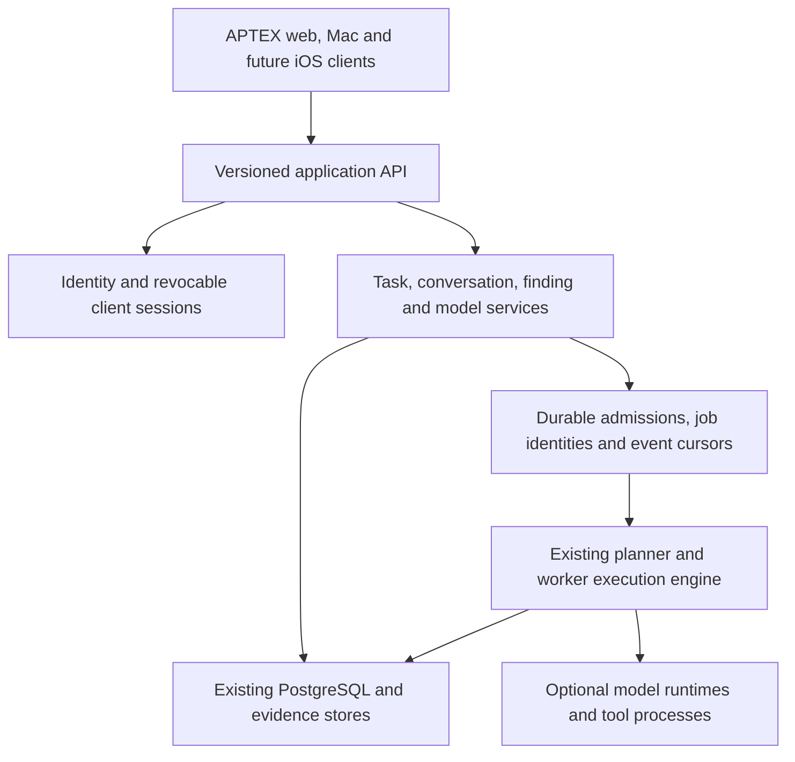

# Server architecture before the iOS client

Status: initial application boundaries implemented, 2026-11-06. The owner paused
iOS implementation until the server architecture and client contract were
settled. The [version 1 client contract](client-api-v1.md) now defines bootstrap,
readiness, revocable sessions and resumable conversation observation. The source
comparison and measurements below describe the pre-migration revision.

## Recommendation

Adopt the useful parts of Odysseus's application-server methodology: a small
connection/bootstrap path, revocable client sessions, separate liveness and
readiness, optional model/tool services, and clients that subscribe to server-owned
jobs. Retain APTEX's existing execution engine and PostgreSQL domain stores while
introducing those boundaries. Freeze the public client contract before resuming
the iOS application.

This changes the server structure without making a Python rewrite a prerequisite.
A separate FastAPI application layer remains an option if sharing substantial
Odysseus server code becomes the objective. It adds a second runtime and an
internal service protocol, so it needs a deliberate migration rather than a
blind fork of Odysseus.

## What the source actually does

| Concern | Current APTEX | Inspected Odysseus | Direction |
| --- | --- | --- | --- |
| Startup | PostgreSQL initialization, recovery, server construction and task restoration precede the HTTP listener | FastAPI lifespan performs critical startup, then schedules optional MCP connections and warmups | Separate critical recovery from optional services; retain the recovery barrier before jobs may resume |
| Models and tools | Task agents are created on demand; MCP discovery is asynchronous; idle provider construction does not require inference | Optional warmups are off by default; model/tool endpoints are loaded on demand | Preserve existing lazy work and expose explicit service status rather than blocking connection on a model |
| Native launcher | Always selects the local-LLM Compose profile, requires a local model directory, and waits for the selected Ollama model | Application server and model endpoints have separate configuration/lifecycles | Make the model runtime optional for API startup; retain this desktop's configured local model and read-only model store |
| Client authentication | Seven-day administrator JWT; bearer, cookie and legacy SSE query-token transports; no per-device session revocation route | Server-tracked random sessions, HttpOnly browser cookie, logout revocation, and native server-scoped Keychain storage | Define APTEX's own revocable device sessions and transport before writing the mobile authentication flow |
| Conversations | PostgreSQL activities and durable chat admissions; cursor polling and revision-checked controls | Native client consumes streamed responses; detached server runs feed a replay buffer | Use a resumable client event contract while preserving APTEX's persisted admissions and run identities |
| Restart behavior | Recovery and explicit unknown-run handling protect durable inputs/history | `src/agent_runs.py` explicitly limits its live replay buffer to one server process | Do not replace APTEX's durable state with an in-memory-only stream manager |
| Readiness | `/api/health` reports process/version; it does not perform a dependency readiness probe | `/api/health` and `/api/ready` have distinct roles | Add a small readiness contract that separates required storage/recovery from optional model availability |
| Feature contracts | Task graphs, findings/evidence, traffic, interception, workflows, model profiles and task-specific routing already exist | General chat/session API plus its own application-specific features | Preserve cybersecurity capabilities and existing identifiers; adapt their public DTOs deliberately |

Odysseus is itself a large application process. Its detached chat task does not
imply that model execution survives a server restart. Adopting its useful
patterns does not require copying all of its feature code or its failure modes.

## Cold-process check

The earlier [client-startup report](client-startup.md) measures downloading and
rendering the web interface. This additional check measures HTTP availability
and basic authenticated API reads, not browser rendering.

The tested APTEX image reports revision `6f7f659c0b13`. An isolated, internal-only
Docker network contained a disposable PostgreSQL database, the application and
a synthetic Ollama endpoint. No production volumes, credentials, tasks or models
were attached. Database storage used tmpfs. Images were already built/cached;
image building, downloading and PostgreSQL initial startup are excluded from the
application-start timer.

The timer starts immediately before `docker run` and ends after a successful
HTTP authentication-status probe executed inside the container. It includes
container start, application initialization and probe overhead. API latencies
were measured on loopback inside that container after synthetic administrator
setup/login; each value is the median of five sequential requests. Task,
conversation and profile collections were empty. There is one application boot
per scenario, so these are controlled observations, not production percentiles.

| Scenario | HTTP availability | Model configured | Requests to model endpoint |
| --- | --- | --- | --- |
| Fresh database, no provider | 803.3 ms | No | 0 |
| Existing database, no provider | 399.5 ms | No | 0 |
| Existing database, synthetic 30-second model endpoint | 447.7 ms | Yes, verified through `/api/llm` | 0 |

Across those scenarios, median task reads were 0.62–0.74 ms, conversation reads
0.41–0.43 ms, profile reads 0.42–0.43 ms, and agent reads 0.89–1.03 ms. The
synthetic provider delays non-audit requests by 30 seconds; the counter confirms
none were made during startup and these reads. No inference was requested.

The [sanitized measurements](server-architecture-measurements.json) retain the
values. The owned fixture containers and network were removed. Neither live
server was restarted. An isolated Odysseus cold boot was not measured, so this
does not establish a server startup speed ratio between the applications.

These results support retaining the existing engine. They do not remove the
need for better server boundaries, and they do not characterize recovery with
a large production history or active jobs.

## Target boundaries

Start by making these explicit code boundaries inside APTEX. Extracting execution
into another process can follow if needed; it must not require a new mobile
protocol or create competing owners of task state. Existing task, finding,
conversation and model-profile IDs remain authoritative. Keep one source of
truth for each persisted record.

APTEX remains separate from Odysseus in accounts, data, signing identity and
service lifecycle. The existing Tailscale Serve routes remain separate: Odysseus
on its configured HTTPS endpoint and APTEX on its own endpoint. No Odysseus
runtime, account store or unrelated video/Cookbook features are prerequisites.

## Decisions to implement before resuming the client

1. **Bootstrap and versioning.** Define the APTEX application identity, supported
   client API version, authenticated capabilities and required/optional service
   states. A mobile connection must not fetch every tool, graph or locale, probe
   providers, or initialize a model to identify the server.
2. **Lifecycle and readiness.** Let the API start without Ollama/model weights
   when those services are not configured. Keep existing local-model installs
   intact. Readiness must test required dependencies with bounded timeouts and
   expose no DSNs, private paths, provider secrets or account tokens. Recovery
   must finish before admitting or resuming work.
3. **Revocable sessions.** Specify login, restore, logout, expiry and password-change
   behavior. Native credentials belong in APTEX's own server-scoped Keychain
   entry; browser credentials should use a secure session transport. Plan the
   transition from legacy JWTs explicitly, preserve gateway scope restrictions,
   and retain rejection of legacy ARTEX identities. New interfaces must not put
   credentials in URLs.
4. **Session and job protocol.** Define conversation/task session types, opaque
   identifiers, cursor pagination/replay, backgrounding/reconnect behavior and
   error envelopes. Preserve idempotent client request IDs, run IDs and optimistic
   control revisions. A late retry or stale stop must not execute a prompt twice
   or cancel a newer run.
5. **Feature and migration parity.** Verify existing web/Mac behavior, task and
   evidence history, scheduler/recovery, encrypted credentials, interception and
   model routing. Model availability and account-specific access flags come from
   the server; clients must not hardcode Luna or enable unsupported programs.
   Keep the patched local Norma dependency and existing module identities intact.
6. **Client gate.** Capture and test the agreed connection/session/job contracts,
   then resume the iOS client against them. Changing internal engine code later
   should not force another authentication or message protocol rewrite.

The initial implementation covers these public contracts, browser session
migration and optional local-runtime startup. Root Go tests (with a disposable
database), build and vet pass; frontend tests and the static build pass. Separate
worker-process extraction remains a future option. It is not required by the
client protocol and has not been implemented.

## Alternatives

| Approach | Benefit | Cost / limitation |
| --- | --- | --- |
| Refactor the existing server around those contracts | Preserves current engine, stores and capabilities; one server runtime during the first migration | Public API/session work and client adaptation are still required |
| New APTEX FastAPI application layer with the existing Go engine behind it | Can reuse selected Odysseus application services and conventions | Two runtimes, internal authentication/RPC, ownership boundaries and migration/parity testing |
| Rewrite the whole execution backend in Python | One implementation language aligned with Odysseus | Reimplements task graphs, evidence, interception, routing, scheduling and recovery; measured idle startup does not justify that cost |

## Inspected sources and paths

APTEX checkout: `afterglow-cybersecurity-gateway`, revision `6f7f659c0b13`:

- [Process initialization](../cmd/artex/main.go), [server construction and provider setup](../server/server.go),
  [manager recovery](../server/manager.go), and [asynchronous MCP discovery](../server/mcpdiscover.go).
- [Authentication](../server/auth.go), [chat controls](../server/chat_controls.go),
  [durable chat identities](../chatstate/types.go), and [native launcher](../scripts/aptex.py).

Odysseus server: `afterglow-labs/odysseus` at `7a7d6faea699`:
`app.py`, `core/auth.py`, `core/database.py`, `core/session_manager.py`,
`routes/auth_routes.py`, `routes/session_routes.py`, `routes/chat_routes.py`,
and `src/agent_runs.py`.

Current Odysseus iOS source: the separate `afterglow-labs/odysseus-ios` checkout
at `f81c2cd09b90`, including `Odysseus/Core/OdysseusAPI.swift`,
`CredentialVault.swift`, the app store, and build/test scripts. The older
`odysseus/ios/` tree is not the current standalone client. This corrects the
source choice without moving or renaming either project.
